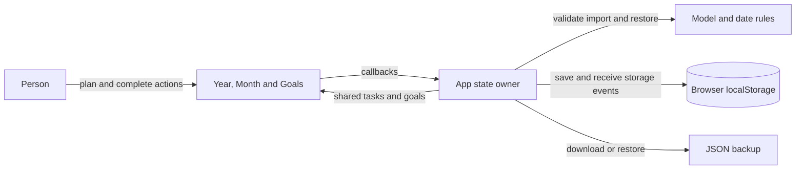

# Architecture

Ultrafocussed is a personal War Map implemented in React and TypeScript. Year, Month and Goals are views of one browser-local state, not separate planning records.

App owns mutations, persistence, storage recovery, task details, keyboard moves and focus sessions. WarMapViews owns presentation and transient form state for goals and calendar selection. Model owns dates, task operations and validation. There is no backend or account boundary.

## Data rules

- INV-1: A task has one identity across every view. Completion, date, goal link, notes and sessions belong to that task. Views never duplicate it. Enforced by shared state and task IDs; checked in UI scheduling/completion tests.
- INV-2: At most four goals belong to any year. Goal IDs are unique; task goal links resolve or are null. Enforced by decode and UI/state limits; checked by model tests.
- INV-3: Removing a goal unlinks tasks without removing or rescheduling them. Enforced by removeGoal and checked in model/UI tests.
- INV-4: Calendar dates use local date keys, with Monday-aligned month grids. They are not UTC instants. Focus session times are elapsed timestamps. Checked by calendar and timer tests.
- INV-5: Saved state remains version 1 under ultrafocussed.planner.v1, with optional goals/goalId fields. Existing task metadata remains intact. Old backups load; malformed new data is rejected before writing. Unreadable storage is left untouched, with recovery actions available.

## Persistence and operation

React state is the source of truth during a session. Changes write the complete state to localStorage. Failed writes retain in-memory work and show export/retry recovery. Imports validate before replacing state, after confirmation. Storage events update other tabs; concurrent edits are last-write-wins, without conflict merging. Browser data clearing loses local data unless a backup exists.

Accepted and implemented: Year/Month/Goals, shared tasks, four annual goals, optional goal links and backward-compatible persistence. No server sync or cross-device persistence. Native browser layout verification is currently blocked by a saved permission preference; automated DOM checks cover behavior and responsive selection, not visual fidelity. See docs/war-map/spec.md for feature checks.
